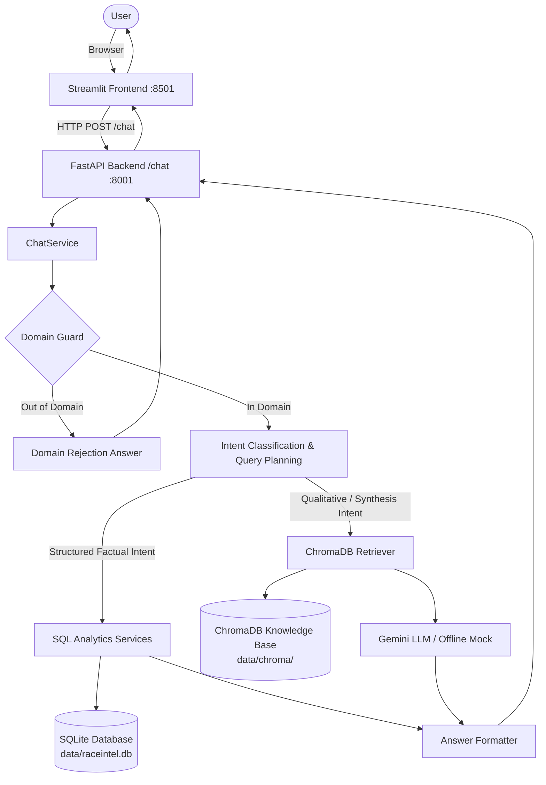

# RaceIntel

RaceIntel is an AI-powered Formula 1 race intelligence platform that combines FastF1 data ingestion, multi-season SQLite analytics, vector-based retrieval and LLM-assisted question answering, with a FastAPI backend and Streamlit interface.

## Features

- **Multi-Season FastF1 Ingestion**: Automated data ingestion pipelines across Formula 1 championship seasons 2022–2026, including Sprint Shootouts and Sprint Races, with atomic SQLite persistence and session synchronization status tracking.
- **Deterministic SQL Analytics**: Zero-hallucination SQL services querying multi-season race classifications, driver and constructor championship standings, weather telemetry, lap pace distributions, and head-to-head driver race comparisons.
- **Vector Retrieval via ChromaDB**: Semantic search over structured race reports and driver performance documents stored in persistent ChromaDB collections, embedded using local SentenceTransformers (`all-MiniLM-L6-v2`).
- **Intent Routing & Domain Guard**: Rule-based intent classification and query planning that routes analytical questions directly to deterministic SQL engines, semantic RAG pipelines, or rapid out-of-domain rejections.
- **Chat Orchestration**: Integrated `ChatService` managing entity resolution, circuit/event alias disambiguation, question routing, ambiguity handling, and generative answer synthesis.
- **Analytics Dashboard**: Modular retro-terminal Streamlit frontend comprising 6 specialized consoles: Dashboard Overview, Race Analysis, Driver Intelligence, Constructor Intelligence, AI Race Engineer, and System / About.
- **Sync Worker Engine**: Background synchronization process featuring atomic lockfiles, process lifecycle verification via process creation timestamps and command-line checks, and safe graceful termination.
- **Comprehensive Test Suite**: 375 automated unit, integration, and regression tests validating offline operation, chronology integrity, API contracts, and worker termination safety.

## Architecture

The diagram below outlines the runtime request lifecycle across user interfaces, API routing, deterministic SQL execution, vector retrieval, and generative answer synthesis:



## Quickstart

### Prerequisites
- Python 3.11 to 3.14 (Python 3.14 recommended; Python 3.10 is incompatible with pinned dependencies in requirements.txt such as `contourpy==1.3.3`)
- Git

### 1. Clone Repository & Setup Environment

#### Windows PowerShell
```powershell
git clone https://github.com/RM-f1/RaceIntel.git
cd RaceIntel
python -m venv venv
.\venv\Scripts\Activate.ps1
python -m pip install --upgrade pip
pip install -r requirements.txt
pip install -e .
```

#### macOS / Linux
```bash
git clone https://github.com/RM-f1/RaceIntel.git
cd RaceIntel
python3 -m venv venv
source venv/bin/activate
pip install --upgrade pip
pip install -r requirements.txt
pip install -e .
```

### 2. Environment Configuration

Create `.env` in the project root:

#### Windows PowerShell
```powershell
Copy-Item .env.example .env
```

#### macOS / Linux
```bash
cp .env.example .env
```

Configure the environment variables in `.env`:
```ini
# Path to local SQLite database (Required by configuration; works offline)
DATABASE_URL=sqlite:///data/raceintel.db

# Admin API authorization secret (Required for POST /api/v1/analytics/sync; works offline)
RACEINTEL_ADMIN_KEY=your_admin_secret_here

# Google Gemini API Key (Optional; required only for live generative chat)
# When empty or when RACEINTEL_OFFLINE=1 is set, the system operates in offline mock mode.
GEMINI_API_KEY=your_gemini_api_key_here

# FastAPI backend base URL for Streamlit frontend (Optional, defaults to http://127.0.0.1:8001; works offline)
RACEINTEL_API_URL=http://127.0.0.1:8001
```

| Variable | Required | Offline Capable | Purpose |
|---|---|---|---|
| `DATABASE_URL` | **Yes** | Yes | Database connection string for SQLite persistence. |
| `RACEINTEL_ADMIN_KEY` | **Yes** (to trigger sync) | Yes | Authenticates admin sync endpoints with fail-closed checks. |
| `GEMINI_API_KEY` | Optional | **No** (Needs Key) | Powers live open-ended RAG synthesis through Google GenAI. |
| `RACEINTEL_API_URL` | Optional | Yes | Backend target URL consumed by Streamlit `RaceIntelAPIClient`. |

### 3. Build the Database (`data/raceintel.db`)

RaceIntel relies on a local SQLite database constructed from FastF1 session data. Build it from scratch:

1. **Initialize Database Schema** (Creates tables, views, and indexes):
   ```bash
   python -c "from database.schema import create_database; create_database()"
   ```
   *(Works offline; creates `data/raceintel.db`)*

2. **Ingest Championship Seasons**:
   ```bash
   # Ingest 2024 season (recommended baseline, 24 rounds + sprints)
   python -m raceintel.data.ingest --season 2024

   # Optionally ingest additional seasons (supports 2022, 2023, 2024, 2025, 2026)
   python -m raceintel.data.ingest --season 2023
   ```
   - **FastF1 Cache Location**: Raw telemetry and timing data downloaded from FastF1 are cached in `data/cache/`.
   - **Ingestion Duration**: Ingestion duration depends on network download speed and whether sessions are already cached locally in `data/cache/`.
   - **Key Dependency**: FastF1 ingestion requires internet access for initial download, but **does NOT require a Gemini API key**.

### 4. Build the ChromaDB Knowledge Base (`data/chroma/`)

Index structured race reports and driver performance summaries into the vector database:

```bash
# Index documents for all seasons currently in SQLite
python -m raceintel.retrieval.season_indexer --all-seasons

# Or index a single season
python -m raceintel.retrieval.season_indexer --season 2024
```
- **Embedding Model**: Chroma uses SentenceTransformers `all-MiniLM-L6-v2` locally.
- **Storage**: Vector data is stored in `data/chroma/`.
- **Key Dependency**: Completely offline; **does NOT require a Gemini API key**.

### 5. Start the Services

#### Terminal 1 — Start the FastAPI Backend:
```bash
uvicorn raceintel.api.main:app --port 8001
```
The backend initializes REST API endpoints at `http://127.0.0.1:8001` (interactive OpenAPI documentation available at `http://127.0.0.1:8001/docs`).

#### Terminal 2 — Start the Streamlit Dashboard:
```bash
streamlit run app.py
```
Open your browser to `http://localhost:8501`. The retro terminal interface includes:
- `01 // DASHBOARD`: Overall championship metrics, event schedule, and sync statuses.
- `02 // RACE ANALYSIS`: Race telemetry, lap times, finishing positions, and weather.
- `03 // DRIVER INTELLIGENCE`: Head-to-head metrics, driver progression, and career statistics.
- `04 // CONSTRUCTOR INTELLIGENCE`: Constructor points progression and teammate comparisons.
- `05 // AI RACE ENGINEER`: Natural-language chat interface for deterministic SQL queries and RAG synthesis.
- `06 // SYSTEM / ABOUT`: Health check statuses, sync worker controls, and database metrics.

## Running Tests

Execute the complete test suite using pytest:

```bash
pytest -p no:cacheprovider
```
or
```bash
python -m pytest -p no:cacheprovider
```

- **Test Suite Status**: **375 passed, 0 failed** (executed in ~35–45s).
- **Offline Guarantee**: The test suite executes **100% offline**. External Gemini calls are intercepted by deterministic offline mock clients (`GeminiClient._generate_mock_response`), SQLite operations use test database sandboxes or atomic rollbacks, and no network traffic is generated.

## Data and Provenance

- **Data Source**: FastF1 library fetching timing data, telemetry feeds, weather logs, and classifications directly from Formula 1 live timing archives.
- **Seasons Supported**: 2022, 2023, 2024, 2025, and 2026 (including Sprint formats).
- **Data Directory Storage**: All database files, vector collections, and raw FastF1 caches (`data/raceintel.db`, `data/chroma/`, `data/cache/`) are strictly gitignored to preserve clean version control. They are generated locally through the schema initialization and ingestion commands.
- **2024 Chronology Bug & Verification**:
  During multi-season scaling, an event numbering discrepancy occurred where the 2024 British Grand Prix was initially stored at Round 1 (from Phase 1 exploration), shifting Bahrain through Austria (Rounds 1–11) one round later in sequential ingestion order.
  - *Repair*: Implemented in `scripts/reconcile_chronology.py`. Exactly 21 metadata records (9 in `events` and 12 in `session_sync_status`, detailed in `evaluation/chronology_reconciliation_report.json`) were corrected to align with the official FastF1 2024 schedule.
  - *Verification*: Verified that all 24 rounds in `events` and `session_sync_status` match the FastF1 schedule exactly (Round 1 Bahrain through Round 24 Abu Dhabi), SQLite foreign keys (`PRAGMA foreign_key_check`) and database integrity (`PRAGMA integrity_check`) report zero violations, and running `python scripts/reconcile_chronology.py` in dry-run mode proposes **0 changes**.
  - *Source Consistency*: Note that this verification compares the SQLite database against FastF1's schedule, which also serves as the ingestion source.

## Evaluation

### Project-Authored Benchmark V2

RaceIntel's analytical accuracy is benchmarked against a frozen, project-authored evaluation protocol documented in [`evaluation/frozen_manifest_2026-11-15.json`](evaluation/frozen_manifest_2026-11-15.json):

- **Dataset**: [`evaluation/raceintel_independent_v2.json`](evaluation/raceintel_independent_v2.json), comprising **80 project-authored questions** across 11 analytical categories.
- **Scorer**: [`evaluation/run_independent_v2.py`](evaluation/run_independent_v2.py). The scoring harness was revised after inspecting earlier benchmark results to enforce strict clause co-occurrence matching (entity + position/metric in the same clause), exact position boundary guards (`P1` cannot match `P10`), and multi-entity RAG completeness metrics (`rag_complete`), unit-tested via `tests/test_phase_5d_evaluator.py`.
- **Execution Mode**: Evaluated strictly **offline** with **0 live Gemini calls attempted**. RAG answers were generated using deterministic mock extraction.
- **Benchmark Run Details**: Executed on **2026-11-15** on git commit `f2ee06a` against the multi-season SQLite database and persistent Chroma vector store. Results are saved in [`evaluation/raceintel_independent_v2_results_2026-11-15.json`](evaluation/raceintel_independent_v2_results_2026-11-15.json).
- **Benchmark Results**:
  - **Overall Answer Accuracy**: **57 / 80 (71.2%)**
  - **Entity Resolution**: **24 / 24 (100.0%)**
  - **Event & Season Resolution**: **71 / 71 (100.0%)**
  - **RAG Retrieval Source Hit Rate**: **9 / 9 (100.0%)**
  - **RAG Answerable Complete Accuracy**: **8 / 9 (88.9%)**
  - **False Abstention Rate**: **0 / 67 (0.0%)**
  - **Category Breakdown**:
    - `weather_and_conditions`: 8/8 (100.0%)
    - `rag_race_reports_and_metadata`: 8/9 (88.9%)
    - `tyres_positions_and_classification`: 7/8 (87.5%)
    - `ambiguous_or_underspecified`: 4/5 (80.0%)
    - `driver_standings_and_points`: 7/9 (77.8%)
    - `pace_and_fastest_laps`: 6/8 (75.0%)
    - `domain_rejection`: 3/4 (75.0%)
    - `race_results_and_winners`: 5/9 (55.6%)
    - `constructor_standings_and_points`: 4/8 (50.0%)
    - `multi_entity_comparisons`: 4/8 (50.0%)
    - `unanswerable_in_domain`: 1/4 (25.0%)

### Evaluation Comparability Note
Earlier development phases recorded higher figures (e.g. 100% on Baseline 30, Eval V2 75, and Holdout 30). **These earlier scores are not comparable to Benchmark V2**:
1. Earlier benchmarks evaluated known reference sets or permitted looser substring matching rules.
2. The benchmark question set is project-authored rather than from an external independent party, and the scorer was revised after inspecting earlier benchmark failures.
3. Offline benchmark testing measures deterministic SQL execution, query routing, entity extraction, and RAG retrieval completeness, but **does not measure live Gemini LLM natural language generation quality**.

Full evaluation run records and methodology audits are preserved in [`evaluation/`](evaluation/).

## Limitations and Known Issues

- **Not a Race Strategy Engine**: RaceIntel is an analytics and intelligence platform, not a predictive race-strategy simulator. It does not perform real-time pit stop strategy optimization, tire degradation modeling with physics simulators, or live undercut/overcut tactical projections.
- **Sync Status Identity Model**: The synchronization tracking model uses `(season, round_number, session_type)` combined with free-text event names. If calendar schedule names drift between FastF1 updates, duplicate tracking records may require manual reconciliation.
- **Incremental Ingestion Skips Completed Records**: The `--incremental` flag skips any session marked `COMPLETED` or `PARTIAL` in `session_sync_status` without verifying if upstream timing data was revised post-race. Use `--force-refresh` to re-fetch sessions.
- **Driver Name & Timing Code Collisions**: Driver resolution relies on surnames and 3-letter timing abbreviations. Abbreviations that collide with common English words (such as `NOR`, `PER`, `GAS`, `BOT`) require strict uppercase boundary guarding.
- **Local Deployment Only**: The system is designed for local development. Containerization (Docker), production reverse proxies, and cloud infrastructure deployments have not yet been implemented.
- **Live LLM Quality Not Systematically Evaluated**: The automated test suite and independent benchmarks execute in offline mode with deterministic mocks. Live generative quality, prompt drift, and Gemini API rate limiting are not measured in CI.

## Roadmap

- **Tyre Stint & Degradation Modeling**: Implement empirical lap-time degradation regressions with statistical confidence intervals.
- **Undercut / Overcut Analysis**: Introduce comparative gap models evaluating pit-in and pit-out delta effectiveness.
- **Production Cloud Deployment**: Docker compose configuration, ASGI production server configuration, and remote database hosting.
- **Frozen Live LLM Benchmark Suite**: Pre-registered live evaluation harness with automated LLM-as-judge scoring for generative synthesis.

## Driver Photos

- Driver portrait images displayed in the Streamlit frontend are fetched by [`scripts/fetch_driver_photos.py`](scripts/fetch_driver_photos.py) directly from Wikimedia Commons.
- Image assets are stored locally in `frontend/assets/drivers/` and are **not tracked in the git repository**.
- Per-image copyright attribution, photographer credits, source URLs, and Creative Commons license details are tracked in [`frontend/driver_photos_catalog.json`](frontend/driver_photos_catalog.json).

## License

RaceIntel is distributed under the **MIT License**. Copyright (c) 2026 Ramandeep Kaur. See the [`LICENSE`](LICENSE) file for the full license text.
