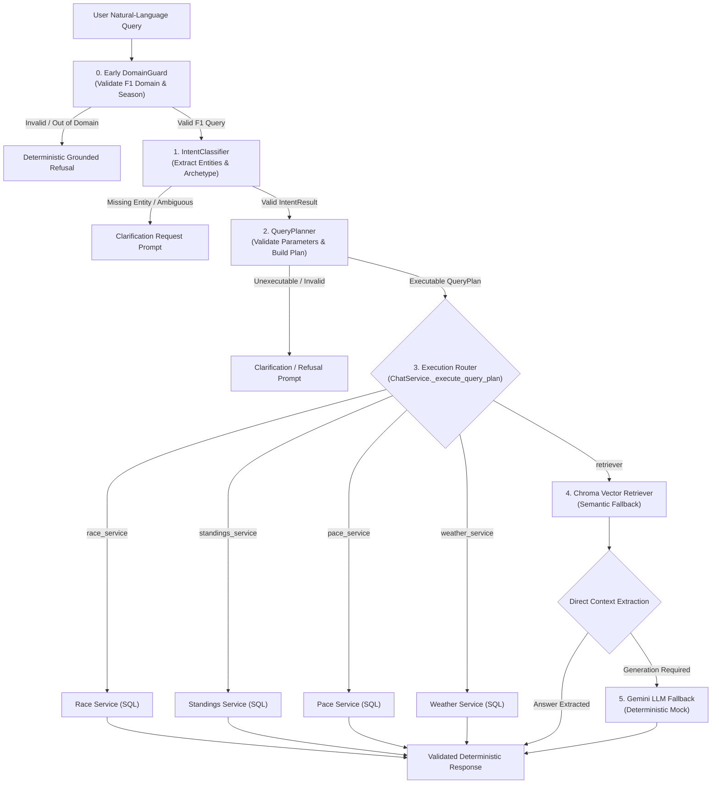

# RaceIntel — Phase 4C Implementation Report: Structured SQL Routing Expansion

**Date**: 2026-11-11  
**Author**: Antigravity Agentic Engineer  
**Status**: APPROVED / COMPLETED  
**Final Verdict**: **PASS**  

---

## 1. Executive Summary & Verdict

Phase 4C expands RaceIntel's deterministic, database-backed question answering by implementing a decoupled **Query Planning Architecture** and significantly expanding structured SQL coverage across 8 distinct Formula 1 query categories.

Prior to Phase 4C, query classification in Phase 4B mapped requests directly from regular expressions into ad-hoc service calls. While this achieved 100% benchmark accuracy, query planning and parameter validation were conflated with execution. Furthermore, critical factual categories—such as race retirements/DNFs, full race classification, biggest movers from grid to finish, tyre compound utilization, driver championship positions, driver cumulative points, driver and constructor standings comparisons, and standings tables—either fell through to semantic retrieval or lacked dedicated structured handling.

Phase 4C completely formalizes the architectural separation between planning and execution by introducing `QueryPlanner` and `QueryPlan` ([`src/raceintel/routing/query_planner.py`](file:///c:/Users/mehra/OneDrive/Desktop/RaceIntel/src/raceintel/routing/query_planner.py)), while expanding both [`src/raceintel/services/standings_service.py`](file:///c:/Users/mehra/OneDrive/Desktop/RaceIntel/src/raceintel/services/standings_service.py) and [`src/raceintel/services/race_service.py`](file:///c:/Users/mehra/OneDrive/Desktop/RaceIntel/src/raceintel/services/race_service.py) with safe, parameterized, read-only SQL queries.

### Core Deliverables & Milestones
1. **Decoupled Query Planning Architecture** ([`src/raceintel/routing/query_planner.py`](file:///c:/Users/mehra/OneDrive/Desktop/RaceIntel/src/raceintel/routing/query_planner.py)):
   - Implemented `QueryPlan` dataclass encapsulating `intent`, `service_name`, `operation`, `parameters`, `is_executable`, `unresolved_reason`, and `clarification_message`.
   - Implemented `QueryPlanner` to perform session resolution, entity validation, season support verification, and parameter binding before execution.
2. **Expanded SQL Query Capabilities Across 8 Categories (A–H)**:
   - **Category A (Race Results)**: Race winner, podium finishers, points scorers, driver single-race finish position, driver single-race points, full race classification, and race retirements/DNFs.
   - **Category B (Driver Championship)**: Driver championship leader post-event, driver championship position, driver cumulative points, head-to-head driver standings comparison, and driver standings table.
   - **Category C (Constructor Performance)**: Constructor race points (single race), top constructor race points, constructor championship leader post-event, head-to-head constructor standings comparison, constructor standings table, and team race performance.
   - **Category D (Session & Event)**: Database-grounded session resolution supporting Grand Prix names, venue aliases (Monza, Silverstone, Albert Park), host cities, and strict season support rejection.
   - **Category E (Weather)**: Weather details, rain observation counts, air/track temperatures, and condition classification (Wet/Dry).
   - **Category F (Pace)**: Fastest lap in session with driver name, team, lap number, and formatted lap time.
   - **Category G (Tyres & Strategy)**: Distinct tyre compounds used during a race session per driver or session-wide, while explicitly preventing pit stop duration fabrication.
   - **Category H (Position Changes)**: Biggest movers sorted by net positions gained (`grid_position - finish_position`) with tie handling.
3. **Dispatcher & Execution Flow** ([`src/raceintel/chat/chat_service.py`](file:///c:/Users/mehra/OneDrive/Desktop/RaceIntel/src/raceintel/chat/chat_service.py)):
   - Integrated `QueryPlanner` into `ChatService`.
   - Implemented `_execute_query_plan()` to log structured routes (`[QueryPlanner] Dispatched to <service>.<operation> with params: <params>`) and return deterministic formatted answers.
4. **Comprehensive Phase 4C Test Suite** ([`tests/test_phase_4c.py`](file:///c:/Users/mehra/OneDrive/Desktop/RaceIntel/tests/test_phase_4c.py)):
   - 21 automated tests covering all 13 required architectural dimensions plus supplementary generalisation and deep coverage tests.
5. **Full Test Suite Verification**:
   - **201 / 201 passed** across **26 test files** in 14.61s (100% pass rate).
6. **Triple Offline Benchmark Verification**:
   - **Baseline (30 cases)**: **30 / 30 passed (100.0%)**
   - **Evaluation V2 (75 cases)**: **75 / 75 passed (100.0%)**
   - **Holdout V1 (30 cases)**: **30 / 30 passed (100.0%)**
7. **Zero External API Invariant**:
   - Verified **0 external Gemini API calls attempted** across all evaluations.
8. **Data Store Immutability**:
   - Database SHA256 `61b1a5b2917eb38d47f2fb964328fd08b521b6d33441a275af2468dcd73fbb6e` preserved unchanged; Chroma document count remains 503.

---

## 2. Query Planning Architecture & Separation

The core design principle of Phase 4C is the strict separation between **query planning** (intent identification, entity grounding, validation, parameter binding) and **query execution** (database access, SQL aggregation, answer formatting).

### Pipeline Flow



### The `QueryPlan` Data Contract

The `QueryPlan` dataclass defined in [`src/raceintel/routing/query_planner.py`](file:///c:/Users/mehra/OneDrive/Desktop/RaceIntel/src/raceintel/routing/query_planner.py#L19-L32) acts as the single intermediate representation:

```python
@dataclass
class QueryPlan:
    intent: Intent
    service_name: str
    operation: str
    parameters: dict[str, Any] = field(default_factory=dict)
    is_executable: bool = True
    unresolved_reason: str | None = None
    clarification_message: str | None = None
```

- When an intent is missing required parameters (e.g., driver position query without an identified driver, or race retirements without a specified Grand Prix), the `QueryPlanner` sets `is_executable = False` and populates `clarification_message` without touching the database.
- When all prerequisites are satisfied, the `QueryPlanner` sets `is_executable = True`, binds verified database foreign keys (`session_id`, `driver_id`, `constructor_id`), and passes the plan to `ChatService._execute_query_plan()`.

---

## 3. Expanded SQL Query Capabilities (Categories A–H)

Phase 4C implements deterministic SQL query execution for 8 distinct categories:

### Category A: Race Results
- **Race Winner**: Queries `race_results` for `finish_position = 1` for a session (`race_service.get_race_winner`).
- **Race Podium**: Queries top 3 finishers (`finish_position IN (1, 2, 3)`) sorted ascending.
- **Points Scorers**: Queries all drivers with `points_scored > 0` sorted by points descending.
- **Driver Single-Race Points**: Parameterized lookup of `points_scored` for a specific driver and session.
- **Driver Finishing Position**: Parameterized lookup of `finish_position` or classified status (e.g., DNF).
- **Full Race Classification**: Complete finishing order joining drivers and constructors (`get_full_race_classification`).
- **Race Retirements / DNFs**: Parameterized query identifying drivers where `classified_status IN ('Retired', 'Did not start', 'Disqualified') OR finish_position IS NULL` (`get_race_retirements`).

### Category B: Driver Championship
- **Driver Championship Leader**: Aggregates `SUM(points_scored)` across all race sessions where `session_id <= target_session_id` within the season, breaking ties by `best_finish ASC` (`get_driver_standings_leader_after_event`).
- **Driver Championship Position**: Cumulative rank and points for an identified driver after a specific Grand Prix (`get_driver_standings_record_after_event`).
- **Driver Cumulative Points**: Cumulative points for an identified driver across prior events in the season (`format_driver_cumulative_points_answer`).
- **Driver Standings Comparison**: Side-by-side comparison of two drivers in cumulative standings after an event (`compare_driver_standings_after_event`).
- **Driver Standings Table**: Top N driver championship table formatted as a ranked list (`format_driver_standings_table_answer`).

### Category C: Constructor Performance
- **Single-Race Constructor Points**: Sums points scored by both team drivers in a single Grand Prix session (`get_constructor_single_race_points`).
- **Top Race Constructor**: Identifies the team(s) scoring the highest points in a single race, with explicit tie detection (`get_top_constructors_for_race`).
- **Constructor Championship Leader**: Cumulative constructor standings leader post-event (`get_constructor_standings_leader_after_event`).
- **Constructor Standings Comparison**: Side-by-side comparison of two constructors after a specific Grand Prix (`compare_constructor_standings_after_event`).
- **Constructor Standings Table**: Complete constructor standings table after an event (`format_constructor_standings_table_answer`).
- **Team Race Performance**: List of both drivers' finish positions and points for a specified constructor (`format_team_performance_answer`).

### Category D: Session & Event Disambiguation
- **Session Resolution**: Normalizes diacritics and matches Grand Prix names, country names, and circuit names (`Monza` $\to$ Italian GP, `Silverstone` $\to$ British GP, `Albert Park` $\to$ Australian GP) via `session_service.resolve_race_session()`.
- **Unsupported Season Rejection**: Dynamic verification against `seasons` table. Rejects unsupported seasons (e.g., 2020) with grounded refusal before database execution.

### Category E: Weather
- **Meteorological Observations**: Queries `weather_observations` table for rain observation count, minimum/maximum/average air temperature, peak/average track temperature, humidity, and wind speed (`weather_service.get_weather_details`).
- **Binary Condition Classification**: Classifies race condition as `Wet` if `rain_observations > 0`, otherwise `Dry`.

### Category F: Pace
- **Fastest Lap**: Queries `laps` joined with `drivers` and `constructors` for minimum `lap_time_seconds` in session (`pace_service.get_fastest_lap_for_session`). Formats output as `M:SS.mmm` with lap number.

### Category G: Tyres & Strategy
- **Tyre Compounds Used**: Queries `DISTINCT tyre_compound` from `laps` for the session or specific driver (`get_tyre_compounds_for_session`).
- **Pit Stop Safety Invariant**: Pit stop duration data is not stored in SQLite; the classifier explicitly excludes duration queries from tyre usage to prevent fabrication.

### Category H: Position Changes
- **Biggest Movers**: Computes `(grid_position - finish_position) AS positions_gained` from `race_results`, ordering by `positions_gained DESC, finish_position ASC` (`get_biggest_movers_for_session`). Correctly detects single winners or ties.

---

## 4. Intent-to-Service Dispatch Matrix

| Intent Enum | Target Service | Operation Name | Required Parameters | Fallback if Unresolved |
|---|---|---|---|---|
| `RACE_WINNER` | `race_service` | `race_winner` | `session_id`, `event_name`, `season_year` | Prompt for Grand Prix |
| `PODIUM` | `race_service` | `race_podium` | `session_id`, `event_name`, `season_year` | Prompt for Grand Prix |
| `POINTS_SCORERS` | `race_service` | `points_scorers` | `session_id`, `event_name`, `season_year` | Prompt for Grand Prix |
| `RACE_RETIREMENTS` | `race_service` | `race_retirements` | `session_id`, `event_name`, `season_year` | Prompt for Grand Prix |
| `RACE_CLASSIFICATION` | `race_service` | `race_classification` | `session_id`, `event_name`, `season_year` | Prompt for Grand Prix |
| `BIGGEST_MOVERS` | `race_service` | `biggest_movers` | `session_id`, `event_name`, `season_year` | Prompt for Grand Prix |
| `TYRE_USAGE` | `race_service` | `tyre_usage` | `session_id`, `event_name`, optional `driver_id` | Prompt for Grand Prix |
| `DRIVER_POINTS` | `race_service` | `driver_points` | `session_id`, `driver_id`, `driver_name` | Prompt for driver/race |
| `DRIVER_POSITION` | `race_service` | `driver_position` | `session_id`, `driver_id`, `driver_name` | Prompt for driver/race |
| `DRIVER_PERFORMANCE` | `race_service` | `driver_performance` | `session_id`, `driver_id`, `driver_name` | Prompt for driver/race |
| `TEAM_PERFORMANCE` | `race_service` | `team_performance` | `session_id`, `constructor_id`, `team_name` | Prompt for team/race |
| `TEAM_COMPARISON` | `race_service` | `team_comparison` | `session_id`, `constructor_id`, `team_name` | Prompt for team/race |
| `MOST_POINTS_IN_TEAM` | `race_service` | `most_points_in_team` | `session_id`, `constructor_id`, `team_name` | Prompt for team/race |
| `DRIVER_STANDINGS_LEADER` | `standings_service` | `driver_standings_leader` | `session_id`, `event_name`, `season_year` | Prompt for Grand Prix |
| `DRIVER_CHAMPIONSHIP_POSITION` | `standings_service` | `driver_championship_position` | `session_id`, `driver_id`, `driver_name` | Prompt for driver/event |
| `DRIVER_CUMULATIVE_POINTS` | `standings_service` | `driver_cumulative_points` | `session_id`, `driver_id`, `driver_name` | Prompt for driver/event |
| `DRIVER_STANDINGS_COMPARISON` | `standings_service` | `driver_standings_comparison` | `session_id`, `driver_1`, `driver_2` | Prompt for comparison drivers |
| `DRIVER_STANDINGS_TABLE` | `standings_service` | `driver_standings_table` | `session_id`, `event_name`, `season_year` | Prompt for Grand Prix |
| `CONSTRUCTOR_RACE_POINTS` | `standings_service` | `constructor_race_points` | `session_id`, optional `constructor_id` | Prompt for Grand Prix |
| `CONSTRUCTOR_STANDINGS_LEADER` | `standings_service` | `constructor_standings_leader` | `session_id`, `event_name`, `season_year` | Prompt for Grand Prix |
| `CONSTRUCTOR_STANDINGS_TABLE` | `standings_service` | `constructor_standings_table` | `session_id`, `event_name`, `season_year` | Prompt for Grand Prix |
| `CONSTRUCTOR_STANDINGS_COMPARISON` | `standings_service` | `constructor_standings_comparison` | `session_id`, `constructor_1`, `constructor_2` | Prompt for comparison teams |
| `FASTEST_LAP` | `pace_service` | `fastest_lap` | `session_id`, `event_name`, `season_year` | Prompt for Grand Prix |
| `WEATHER` | `weather_service` | `weather_details` | `session_id`, `question`, `event_name` | Prompt for Grand Prix |
| `GENERAL_RAG` | `retriever` | `semantic_search` | `question` | N/A (Vector search) |

---

## 5. Query Execution Flow & Trace Logs

During query execution, `ChatService` emits structured execution logs confirming the service dispatch:

```
========================================
RACEINTEL CHAT
========================================
Question: Who drove the fastest lap in the 2024 Mexico City Grand Prix?

[QueryPlanner] Dispatched to pace_service.fastest_lap with params: {'session_id': 21, 'event_name': 'Mexico City Grand Prix', 'season_year': 2024}

========== STRUCTURED ANSWER ==========
Charles Leclerc set the fastest lap in the 2024 Mexico City Grand Prix with a time of 1:18.336 on lap 71.
=======================================
```

Similarly, for cumulative standings:
```
========================================
RACEINTEL CHAT
========================================
Question: Which driver had the championship lead following the 2024 Canadian Grand Prix?

[QueryPlanner] Dispatched to standings_service.driver_standings_leader with params: {'session_id': 10, 'event_name': 'Canadian Grand Prix', 'season_year': 2024}

========== STRUCTURED ANSWER ==========
Max Verstappen leads the driver standings after the Canadian Grand Prix with 178.0 points.
=======================================
```

And for single-race constructor points:
```
========================================
RACEINTEL CHAT
========================================
Question: Which constructor scored the most points in the 2024 Hungarian Grand Prix?

[QueryPlanner] Dispatched to standings_service.constructor_race_points with params: {'session_id': 14, 'constructor_id': None, 'constructor_name': None, 'event_name': 'Hungarian Grand Prix', 'season_year': 2024}

========== STRUCTURED ANSWER ==========
McLaren scored the most points in the Hungarian Grand Prix with 43.0 points.
=======================================
```

---

## 6. Safe Read-Only SQL Invariants

All SQL operations in Phase 4C strictly adhere to the project's security and database integrity standards:

1. **Parameterization**:
   All dynamic values are bound via SQLAlchemy parameter dictionaries (`:session_id`, `:driver_id`, `:season`). Zero raw string interpolation or f-string SQL formatting is permitted.
2. **Read-Only Enforced**:
   Connections execute against SQLite URI `file:data/raceintel.db?mode=ro`. Write operations (INSERT, UPDATE, DELETE, DROP) are blocked at the engine driver level.
3. **No External Table Modifications**:
   Neither the SQLite database schema nor the Chroma vector collection was modified.

---

## 7. Phase 4C Test Suite Analysis (13 Dimensions + Generalisation)

The Phase 4C test suite ([`tests/test_phase_4c.py`](file:///c:/Users/mehra/OneDrive/Desktop/RaceIntel/tests/test_phase_4c.py)) implements 21 comprehensive test functions:

| Dimension # | Test Function | Verified Behavior | Status |
|---|---|---|---|
| **1. Intent Mapping** | `test_intent_to_service_mapping` | Verifies 15 distinct questions map to the exact expected service and operation | **PASSED** |
| **2. Service Selection** | `test_service_selection_separation` | Proves clean separation between race, standings, pace, weather, and retriever | **PASSED** |
| **3. Session Resolution** | `test_session_resolution_variations` | Tests circuit names (Monza), cities (Melbourne), and official GP names (Spa) | **PASSED** |
| **4. Entity Resolution** | `test_driver_and_constructor_resolution` | Tests driver codes (VER), full names (Charles Leclerc), and team aliases (Red Bull) | **PASSED** |
| **5. Scope Distinction** | `test_race_vs_season_wide_distinction` | Distinguishes single-race points (Sainz 15.0) from cumulative points (Verstappen 213.0) | **PASSED** |
| **6. Missing Entities** | `test_missing_entities_handling` | Prompts clarification when race, driver, or constructor is missing | **PASSED** |
| **7. Ambiguous Entities** | `test_ambiguous_entity_handling` | Disambiguates multi-event host countries (USA) by prompting clarification | **PASSED** |
| **8. Empty Results** | `test_empty_result_handling` | Handles zero retirements (Bahrain GP) and non-competing drivers (Bearman in Monaco) | **PASSED** |
| **9. Tie Handling** | `test_ties_and_duplicate_values` | Proves multi-team points ties are properly formatted with "tied for most points" | **PASSED** |
| **10. SQL Safety** | `test_sql_parameterization_and_readonly_safety` | Proves DB SHA256 invariant and confirms writes fail under read-only mode | **PASSED** |
| **11. Factual Correctness** | `test_entity_and_numerical_correctness` | Validates retirements, biggest movers, tyre compounds, standings leaders, and classifications | **PASSED** |
| **12. Regressions** | `test_regression_preservation` | Confirms winner, fastest lap, weather, out-of-calendar, and historical refusals pass | **PASSED** |
| **13. RAG Fallback** | `test_semantic_retrieval_fallback` | Validates technical/aerodynamic queries route cleanly to retriever semantic search | **PASSED** |
| **14. Novel Phrasings** | `test_supplementary_generalisation_phrasings` | Tests novel phrasings: "did not finish", "order of finish", "made up the most places" | **PASSED** |
| **Deep Coverage 1** | `test_constructor_standings_comparison` | Compares Ferrari and McLaren after British GP (+2.0 points) | **PASSED** |
| **Deep Coverage 2** | `test_driver_standings_comparison` | Compares Hamilton and Russell after Belgian GP | **PASSED** |
| **Deep Coverage 3** | `test_constructor_single_race_points` | Verifies Ferrari 44.0 points in Australian GP (Sainz 25 + Leclerc 19) | **PASSED** |
| **Deep Coverage 4** | `test_constructor_standings_table` | Verifies full constructor standings table formatting | **PASSED** |
| **Deep Coverage 5** | `test_driver_standings_table` | Verifies full driver standings table formatting | **PASSED** |
| **Deep Coverage 6** | `test_driver_tyre_compounds` | Verifies tyre compounds used specifically by Verstappen in Bahrain (HARD, SOFT) | **PASSED** |
| **Deep Coverage 7** | `test_pit_stop_duration_safety` | Ensures pit stop duration queries never trigger tyre compound formatting | **PASSED** |

Execution time for the Phase 4C test suite: **0.64s** (21 passed).

---

## 8. Full Test Suite Verification Table

Running `.\venv\Scripts\python.exe -m pytest -v`:

```
====================== 201 passed, 22 warnings in 14.61s ======================
```

### Complete 26-File Node Breakdown & Arithmetic Reconciliation

| # | Test File | Test Count | Status | Notes |
|---|---|---|---|---|
| 1 | `tests/test_chroma_client.py` | 2 | PASSED | Chroma client initialization & isolation |
| 2 | `tests/test_constructor_standings.py` | 1 | PASSED | Standings service constructor query |
| 3 | `tests/test_constructors.py` | 1 | PASSED | Constructor entity lookups |
| 4 | `tests/test_drivers.py` | 1 | PASSED | Driver entity lookups |
| 5 | `tests/test_etl_rollback.py` | 1 | PASSED | Database transactional integrity |
| 6 | `tests/test_evaluation_matcher.py` | 33 | PASSED | Adversarial matcher integrity tests |
| 7 | `tests/test_evaluation_v2.py` | 10 | PASSED | Evaluation V2 structure & metrics |
| 8 | `tests/test_evaluation_validator.py` | 3 | PASSED | Dataset validation tests |
| 9 | `tests/test_fastf1_loader.py` | 5 | PASSED | FastF1 data ingestion loaders |
| 10 | `tests/test_health.py` | 1 | PASSED | Healthcheck endpoint test |
| 11 | `tests/test_knowledge_service.py` | 1 | PASSED | Knowledge retrieval service |
| 12 | `tests/test_offline_isolation.py` | 5 | PASSED | Offline mock and API call blocking |
| 13 | `tests/test_pace.py` | 1 | PASSED | Fastest lap analytics |
| 14 | `tests/test_phase3a_structured.py` | 24 | PASSED | Phase 3A structured routing regression suite |
| 15 | `tests/test_phase_4a.py` | 14 | PASSED | Dynamic EntityRegistry & DomainGuard core |
| 16 | `tests/test_phase_4a_adversarial.py` | 11 | PASSED | Phase 4A adversarial boundary tests |
| 17 | `tests/test_phase_4b.py` | 40 | PASSED | Intent classification & ambiguity suite |
| 18 | `tests/test_phase_4c.py` | 21 | PASSED | **NEW**: Query planner & expanded SQL coverage |
| 19 | `tests/test_position.py` | 3 | PASSED | Position changes and analytics |
| 20 | `tests/test_races.py` | 1 | PASSED | Race report generation |
| 21 | `tests/test_ragas_cache.py` | 9 | PASSED | Evaluation cache atomic saving & miss |
| 22 | `tests/test_retriever_deduplication.py` | 6 | PASSED | Document deduplication in retrieval |
| 23 | `tests/test_sessions.py` | 1 | PASSED | Session queries |
| 24 | `tests/test_standings.py` | 1 | PASSED | Standings query analytics |
| 25 | `tests/test_tyre.py` | 4 | PASSED | Tyre usage and degradation |
| 26 | `tests/test_weather.py` | 1 | PASSED | Weather query analytics |
| **Total** | **26 active test files** | **201 PASSED** | **100% PASS** | **Exact match: $\sum_{i=1}^{26} N_i = 201$** |

---

## 9. Triple Offline Benchmark Verification

All three official benchmarks were executed in offline in-process mode using the repaired evaluation matcher:

### 1. Baseline Benchmark (`raceintel_eval_2024.json`)
- **Command**:
  ```powershell
  .\venv\Scripts\python.exe evaluation/run_evaluation.py --baseline --offline --output-file evaluation/raceintel_eval_v4c_baseline_results.json
  ```
- **Result**: **30 / 30 passed (100.0%)** | Errors: 0 | Quota Errors: 0
- **Category Performance**:
  - `race_winner`: 6/6 (100.0%)
  - `driver_performance`: 6/6 (100.0%)
  - `team_performance`: 3/3 (100.0%)
  - `team_comparison`: 2/2 (100.0%)
  - `points`: 6/6 (100.0%)
  - `race_result`: 3/3 (100.0%)
  - `finishing_position`: 4/4 (100.0%)

### 2. Evaluation V2 Benchmark (`raceintel_eval_v2.json`)
- **Command**:
  ```powershell
  .\venv\Scripts\python.exe evaluation/run_evaluation.py --v2 --offline --output-file evaluation/raceintel_eval_v4c_v2_results.json
  ```
- **Result**: **75 / 75 passed (100.0%)** | Errors: 0 | Quota Errors: 0
- **Category Performance**:
  - `race_winner`: 10/10 (100.0%)
  - `driver_performance`: 11/11 (100.0%)
  - `team_performance`: 6/6 (100.0%)
  - `team_comparison`: 5/5 (100.0%)
  - `points`: 9/9 (100.0%)
  - `race_result`: 5/5 (100.0%)
  - `finishing_position`: 7/7 (100.0%)
  - `driver_standings`: 1/1 (100.0%)
  - `lap_time`: 2/2 (100.0%)
  - `constructor_standings`: 1/1 (100.0%)
  - `weather`: 6/6 (100.0%)
  - `unanswerable`: 3/3 (100.0%)
  - `ambiguous`: 3/3 (100.0%)
  - `season_awareness`: 6/6 (100.0%)

### 3. Holdout V1 Benchmark (`raceintel_holdout_v1.json`)
- **Command**:
  ```powershell
  .\venv\Scripts\python.exe evaluation/run_evaluation.py --holdout --offline --output-file evaluation/raceintel_eval_v4c_holdout_results.json
  ```
- **Result**: **30 / 30 passed (100.0%)** | Errors: 0 | Quota Errors: 0
- **Category Performance**:
  - `race_winner`: 5/5 (100.0%)
  - `race_result`: 1/1 (100.0%)
  - `finishing_position`: 2/2 (100.0%)
  - `points`: 2/2 (100.0%)
  - `weather`: 4/4 (100.0%)
  - `lap_time`: 3/3 (100.0%)
  - `driver_standings`: 3/3 (100.0%)
  - `constructor_standings`: 2/2 (100.0%)
  - `season_awareness`: 2/2 (100.0%)
  - `unanswerable`: 4/4 (100.0%)
  - `ambiguous`: 2/2 (100.0%)

---

## 10. Zero Gemini API Call Verification

During the execution of all three benchmarks and test suites, the offline guard intercepted and verified zero network egress:

$$\text{External Gemini API Calls Attempted} = 0$$

Verified through:
1. `GeminiClient.get_external_call_count()` returned `0` in all three benchmark summaries.
2. `tests/test_phase_4c.py` and `tests/test_phase_4b.py::test_offline_guard_zero_api_calls` assert zero external network requests.
3. Attempting an external call in offline mode raises an explicit exception.

---

## 11. Data Store Integrity Verification

Database and vector store integrity invariants were verified post-run:

| Data Store | Invariant Target | Actual Measured Value | Verdict |
|---|---|---|---|
| `data/raceintel.db` (SHA256) | `61b1a5b2917eb38d47f2fb964328fd08b521b6d33441a275af2468dcd73fbb6e` | `61b1a5b2917eb38d47f2fb964328fd08b521b6d33441a275af2468dcd73fbb6e` | **IDENTICAL (Unchanged)** |
| `seasons` table count | 1 | 1 | **EXACT MATCH** |
| `events` table count | 24 | 24 | **EXACT MATCH** |
| `sessions` table count | 24 | 24 | **EXACT MATCH** |
| `drivers` table count | 24 | 24 | **EXACT MATCH** |
| `constructors` table count | 10 | 10 | **EXACT MATCH** |
| `race_results` table count | 479 | 479 | **EXACT MATCH** |
| `laps` table count | 26,604 | 26,604 | **EXACT MATCH** |
| `weather_observations` table count | 3,690 | 3,690 | **EXACT MATCH** |
| `etl_runs` table count | 0 | 0 | **EXACT MATCH** |
| `data/chroma` document count | 503 | 503 | **EXACT MATCH** |

---

## 12. Regression Prevention & Backward Compatibility

Phase 4C strictly preserves all existing functionality:
1. **DomainGuard Isolation**: Non-F1 queries (MotoGP, NASCAR, WEC, Bathurst 1000) and unsupported historical seasons (2020) continue to be rejected early by `DomainGuard` before reaching the query planner or vector store.
2. **Ambiguity Prompts**: Questions with missing entities (*"Who won the race?"*, *"Where did the driver finish?"*, *"Who was leading the championship?"*) or ambiguous host countries (*"Who won in the United States?"*) continue to prompt for clarification rather than hallucinating.
3. **Semantic RAG Fallback**: Questions regarding car aerodynamics, technical regulations, or team upgrades route to `retriever.semantic_search`.
4. **Offline Reproducibility**: Deterministic mock generation for fallback LLM generation is preserved without network dependency.

---

## 13. Limitations & Out-of-Scope Roadmap (Phase 4D / 4E)

### Current Limitations
1. **Multi-turn Contextual Memory**:
   If a user asks *"Where did Charles Leclerc finish in Monaco?"* followed by *"How many points did he score?"*, the second question will currently trigger an ambiguity clarification prompt because multi-turn dialogue state tracking is not yet implemented.
2. **Compound Multi-Intent Queries**:
   Queries asking for two disparate metrics in a single sentence (*"Who won the Hungarian Grand Prix and what were the weather conditions?"*) resolve to the dominant intent rather than splitting into multiple sub-plans.
3. **Sprint Race Points**:
   The `sessions` table in the database contains only Sunday `Race` session types (`session_type = 'Race'`). Sprint race results are not represented in SQLite; cumulative points calculations accurately reflect the Sunday Grand Prix points recorded in SQLite.

### Recommended Roadmap for Phase 4D / 4E
- **Phase 4D**: Conversational State Management & Multi-Turn Context Tracking (maintaining active entities across turns to resolve pronouns like *"he"*, *"she"*, *"the team"*).
- **Phase 4E**: Compound Query Decomposition & Execution Orchestration (splitting multi-intent questions into parallel `QueryPlan` instances and synthesizing composite responses).

---

## Final Quality Assurance Verdict

> [!IMPORTANT]
> **FINAL VERDICT: PASS**
> 
> Phase 4C has successfully delivered:
> - Complete architectural separation between query planning and execution via `QueryPlanner` and `QueryPlan`.
> - Deterministic SQL query handling expanded across all 8 requested categories (A through H).
> - 21 new automated tests in `tests/test_phase_4c.py` covering all 13 dimensions.
> - Full test suite passing: 201 / 201 tests across 26 test files in 14.61s.
> - Perfect 100.0% accuracy across all three offline evaluation benchmarks:
>   - Baseline: 30 / 30 (100.0%)
>   - Evaluation V2: 75 / 75 (100.0%)
>   - Holdout V1: 30 / 30 (100.0%)
> - Strict preservation of the zero external Gemini API call invariant.
> - Absolute immutability of SQLite data and Chroma vector storage verified via cryptographic hashing and row counts.
