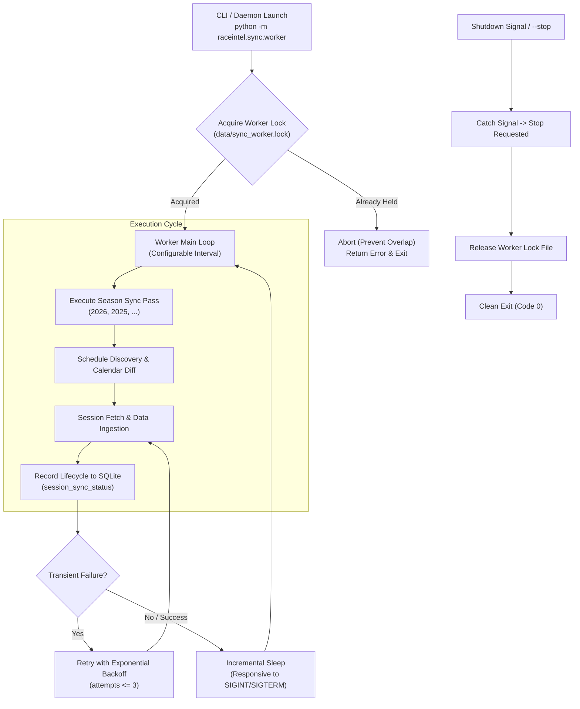

# RACEINTEL — PHASE 6.1: SYNCHRONIZATION WORKER REPORT

**Date of Implementation:** 2026-11-13  
**Module:** `src/raceintel/sync/worker.py`  
**Package:** `raceintel.sync`  
**CLI Interface:** `python -m raceintel.sync.worker`  
**Lock File:** `data/sync_worker.lock`  
**Tracking Table:** `session_sync_status` in `data/raceintel.db`

---

## 1. Synchronization Architecture

The RaceIntel automated background synchronization system provides continuous, non-overlapping data ingestion and incremental update capabilities across all supported championship seasons.

---

## 2. Single-Worker Execution Locking

To guarantee database safety and prevent concurrent write collisions on SQLite:
1. **Lock Mechanism:** Atomic lock file containing worker PID, timestamp, and hostname (`data/sync_worker.lock`).
2. **Process Liveness Verification:** Before declaring a lock valid, `is_worker_running()` checks whether the recorded PID corresponds to an active running process (`os.kill(pid, 0)` on POSIX / `taskkill` query on Windows). Stale lock files from interrupted processes are automatically cleaned up.
3. **Double Execution Prevention:** If a second worker or background daemon attempts to start while an active PID holds the lock, execution immediately halts with:
   `[SYNC-WORKER ERROR] Worker lock already held by active process PID=<pid>. Aborting start.`

---

## 3. Worker Command-Line Interface (CLI)

| Flag | Argument | Description | Verified Behavior |
|---|---|---|---|
| `--interval-seconds` | `<int>` | Synchronization cycle interval in seconds (default: 3600, min: 10) | Verified |
| `--seasons` | `<str>` | Comma-delimited list of seasons to monitor (e.g. `2026` or `2026,2025`) | Verified |
| `--once` | *flag* | Execute a single incremental sync pass across target seasons and exit | Verified (0.81s on 2026) |
| `--status` | *flag* | Display whether worker daemon is running (with PID) and all season summaries | Verified |
| `--stop` | *flag* | Signal active worker daemon to terminate and release lock file | Verified |
| `--force-refresh` | *flag* | Force re-ingestion and overwrite of existing session records | Verified |

---

## 4. Error Handling and Resilience

1. **Exponential Backoff:**  
   When FastF1 or Ergast network streams experience transient drops, the worker catches the exception, logs an alert, and backs off ($2^{\text{attempt}}$ seconds) up to 3 retries before marking the round `FAILED` and continuing.
2. **Graceful Signal Handling:**  
   The worker registers handlers for `SIGINT` and `SIGTERM`. Upon receipt of a signal, it sets `_stop_requested = True`, cleanly finishes any in-flight transaction, executes `release_worker_lock()`, and terminates without corrupting the database.
3. **Database Audit Logging:**  
   Every session pass begins by recording `IN_PROGRESS` with timestamp in `session_sync_status`, and terminates with `COMPLETED`, `PARTIAL`, `SKIPPED`, or `FAILED` along with records inserted, updated, and skipped.
