# RaceIntel — Phase 4, Task 1: Generalised Intent Routing Audit Report

**Status**: Completed  
**Type**: Read-Only Architecture & Failure Audit  
**Date**: November 11, 2026  
**Target File**: `evaluation/PHASE_4_ROUTING_AUDIT.md`  

---

## 1. Executive Summary

### 1.1 Objective and Scope
This audit conducts an exhaustive, read-only investigation of RaceIntel's question-routing architecture. Following Phase 3A (SQLite-backed structured queries) and Phase 3C (matcher hardening and offline reproducibility), RaceIntel attained 100.0% accuracy on the 30-case Baseline benchmark and 100.0% on the 75-case Evaluation V2 benchmark. However, when subjected to the independent 30-question Holdout V1 dataset in Phase 3C.3, accuracy dropped to **86.7%** (26/30 passing, 4 failing, plus 1 latent data corruption).

The objective of this audit is to:
1. Diagnose the exact root causes of all Holdout V1 failures and latent degradations.
2. Uncover deep architectural brittle points in intent detection, entity resolution, ambiguity handling, and fallback execution.
3. Formulate a comprehensive, generalised, production-grade routing architecture that eliminates benchmark over-fitting and provides robust handling for natural language phrasing, ambiguous inquiries, and out-of-domain motorsport questions.
4. Establish a phased implementation roadmap with rigorous acceptance criteria and test designs.

---

### 1.2 Summary of Benchmark Performance & Failure Inventory

| Dataset | Total Cases | Passed | Failed | Accuracy | Notes |
| :--- | :---: | :---: | :---: | :---: | :--- |
| **Baseline Benchmark** | 30 | 30 | 0 | **100.0%** | Basic 2024 race queries, weather, and standings |
| **Evaluation V2 Benchmark** | 75 | 75 | 0 | **100.0%** | Full regression benchmark (repaired in Phase 3A/3C) |
| **Holdout V1 Dataset** | 30 | 26 | 4 | **86.7%** | Independent questions with varied conversational phrasing |

#### Failed Cases on Holdout V1:
1. **Case 102 (`race_winner`)**:  
   *Question*: *"Which driver claimed victory at the Miami Grand Prix in 2024?"*  
   *Expected*: `Lando Norris`  
   *Actual*: `"Alexander Albon won the race, finishing P1."`  
   *Classification*: Factually Wrong (Hallucination / Cross-block regex corruption).
2. **Case 117 (`driver_standings`)**:  
   *Question*: *"Who was leading the drivers' championship after the 2024 Bahrain Grand Prix?"*  
   *Expected*: `Max Verstappen`  
   *Actual*: `"I couldn't find that information in the retrieved race data."`  
   *Classification*: Routing Bypass / Premature Refusal.
3. **Case 119 (`driver_standings`)**:  
   *Question*: *"Which driver had the championship lead following the 2024 Canadian Grand Prix?"*  
   *Expected*: `Max Verstappen`  
   *Actual*: `"I couldn't find that information in the retrieved race data."`  
   *Classification*: Routing Bypass / Premature Refusal.
4. **Case 122 (`constructor_standings`)**:  
   *Question*: *"Which team collected the highest number of points in the 2024 Bahrain Grand Prix?"*  
   *Expected*: `Red Bull Racing`  
   *Actual*: `" scored 0.0 points, finishing P15."`  
   *Classification*: Routing Bypass & Data Corruption (Empty driver string).

#### Latent / Masked Degradations Discovered During Audit:
5. **Case 109 (`points`)**:  
   *Question*: *"How many championship points did Carlos Sainz score in the 2024 Bahrain Grand Prix?"*  
   *Expected*: `15.0`  
   *Actual*: `" scored 15.0 points, finishing P3."`  
   *Matcher Result*: `PASS` (Masked by numerical extractor finding `15.0`, despite missing driver name).
6. **Out-of-Domain Vector Leakage (Cases 127 & 128: Bathurst 1000 & MotoGP)**:  
   ChromaDB semantic search returns 3,282 characters of F1 text for MotoGP because cosine similarity is below the 0.55 distance threshold. Bypasses pre-retrieval validation; relies entirely on offline mock heuristics.

---

## 2. Current Routing Architecture & Request Flow

### 2.1 End-to-End Execution Flowchart

```mermaid
flowchart TD
    UserQuery["User Query (Natural Language)"] --> ChatServiceAsk["ChatService.ask(question)"]
    
    subgraph S1["1. Filter & Entity Extraction"]
        ChatServiceAsk --> ExtractFilters["Retriever._extract_filters(question)"]
        ExtractFilters --> RegexSeason["Season: regex (19\d{2}|20\d{2})"]
        ExtractFilters --> DictRace["Race: Substring in RACES (hardcoded)"]
        ExtractFilters --> DictDriver["Driver: Substring in DRIVERS (hardcoded)"]
        ExtractFilters --> DictTeam["Team: Substring in TEAMS (hardcoded)"]
        ExtractFilters --> DocTypeHeuristic{"Team or Driver present OR<br/>DRIVER_KEYWORDS in q?"}
        DocTypeHeuristic -- Yes --> DocTypeDriver["document_type = 'driver_report'"]
        DocTypeHeuristic -- No --> DocTypeRace["document_type = 'race_report'"]
    end
    
    subgraph S2["2. Ambiguity Check"]
        DocTypeDriver --> CheckAmbiguous["ChatService._check_ambiguous(q, filters)"]
        DocTypeRace --> CheckAmbiguous
        CheckAmbiguous --> StrictRegexRace{"Strict ^...$ race regex<br/>AND not race_name?"}
        StrictRegexRace -- Yes --> AmbRaceClarify["Return 'Please specify which Grand Prix...'"]
        StrictRegexRace -- No --> StrictRegexDriver{"Strict pronoun regex<br/>AND not driver?"}
        StrictRegexDriver -- Yes --> AmbDriverClarify["Return 'Please specify which driver...'"]
        StrictRegexDriver -- No --> PassAmbiguity["Pass to Structured Router"]
    end

    subgraph S3["3. Structured SQLite Routing"]
        PassAmbiguity --> RouteStructured["ChatService._route_structured_query(q, filters)"]
        RouteStructured --> StandingsCheck{"Matches 6 exact<br/>standings phrases?"}
        StandingsCheck -- Yes --> SQLStandings["SQLite Cumulative Standings"]
        StandingsCheck -- No --> ConstructorCheck{"Matches team +<br/>'most points'/'points scored'?"}
        ConstructorCheck -- Yes --> SQLConstructor["SQLite Constructor Points"]
        ConstructorCheck -- No --> FastestLapCheck{"Matches 'fastest lap'/<br/>'quickest lap'/'best lap'?"}
        FastestLapCheck -- Yes --> SQLFastestLap["SQLite Fastest Lap"]
        FastestLapCheck -- No --> WeatherCheck{"Matches word 'rain' OR<br/>7 weather phrases?"}
        WeatherCheck -- Yes --> SQLWeather["SQLite Weather Details"]
        WeatherCheck -- No --> PassToRAG["Pass to Retrieval"]
    end

    subgraph S4["4. Document Retrieval (ChromaDB)"]
        PassToRAG --> RetrieveDocs["Retriever.retrieve(question)"]
        RetrieveDocs --> CheckSpecificDriver{"race_name + driver/team + season?"}
        CheckSpecificDriver -- Yes --> GetDriverReport["Deterministic Chroma: specific driver/team"]
        CheckSpecificDriver -- No --> CheckDeterministicAll{"race_name + doc_type=='driver_report'<br/>AND not driver AND not team?"}
        CheckDeterministicAll -- Yes --> GetAllDrivers["Fetch all 20 driver reports,<br/>SORT ALPHABETICALLY (Albon first)"]
        CheckDeterministicAll -- No --> CheckRaceReport{"race_name + doc_type=='race_report'?"}
        CheckRaceReport -- Yes --> GetRaceReport["Deterministic Chroma: race_report"]
        CheckRaceReport -- No --> FallbackVector["Semantic Vector Search (k=4, dist<0.55)"]
    end

    subgraph S5["5. Out-of-Calendar Post-Check"]
        GetAllDrivers --> ContextCheck{"if not context?"}
        GetRaceReport --> ContextCheck
        GetDriverReport --> ContextCheck
        FallbackVector --> ContextCheck
        ContextCheck -- Context Empty --> CheckOOD{"Season != 2024 OR<br/>OOD term in q?"}
        CheckOOD -- Yes --> OODRefusal["Refuse: Not in 2024 calendar / Season unavailable"]
        CheckOOD -- No --> DirectAnswer
        ContextCheck -- Context Not Empty --> DirectAnswer["ChatService._direct_answer(q, context)"]
    end

    subgraph S6["6. Direct Answer & Fallback Generation"]
        DirectAnswer --> ParseContext["_extract_driver_results() & _extract_race_info()"]
        ParseContext --> SubRules{"Evaluate 9 Hardcoded Sub-Handlers:<br/>who won, how many points, position did,<br/>who scored points, podium, finished higher,<br/>most points, fastest lap, team result"}
        SubRules -- Match Found --> DirectReturn["Return Formatted Deterministic Answer"]
        SubRules -- No Match --> GeminiFallback["GeminiClient.generate(prompt)"]
        GeminiFallback --> OfflineCheck{"Offline Mode?"}
        OfflineCheck -- True --> DeterministicMock["_generate_mock_response() (gemini.py)"]
        OfflineCheck -- False --> LiveGemini["Live Gemini API Call"]
    end
```



---

### 2.2 Component Responsibility Matrix

| Component | Source File | Line Range | Current Responsibilities | Key Deficiencies |
| :--- | :--- | :--- | :--- | :--- |
| **`ChatService`** | `src/raceintel/chat/chat_service.py` | 18–867 | Orchestrates request flow; checks ambiguity; routes structured queries; executes direct answer heuristics. | Fragmented routing logic; tight coupling to specific phrasing; 4 duplicate team dictionaries. |
| **`Retriever`** | `src/raceintel/retrieval/retriever.py` | 6–811 | Extracts metadata filters; builds Chroma `where` clauses; handles deterministic vs semantic retrieval. | Incomplete entity lists (no circuit names, missing reserve drivers); over-eager driver report typing. |
| **`SessionService`** | `src/raceintel/services/session_service.py` | 44–140 | Resolves user race strings to SQLite session and event IDs using fuzzy and diacritic-insensitive matching. | Excellent capability, but underutilized: bypassed because retriever fails to extract race names for circuits. |
| **`StandingsService`** | `src/raceintel/services/standings_service.py` | 63–220 | Computes genuine cumulative driver championship standings and constructor race points. | Rigid entry keywords in `chat_service.py` prevent queries with natural phrasing from ever reaching it. |
| **`WeatherService`** | `src/raceintel/services/weather_service.py` | 30–162 | Analyzes rainfall observations, temperature min/max/avg, and deterministically formats weather replies. | Keyword matching for 'rain' vs 'Bahrain' is brittle; questions without explicit 'rain/weather' bypass it. |
| **`PaceService`** | `src/raceintel/services/pace_service.py` | 40–91 | Queries lowest lap time and driver in session from SQLite `laps` table. | Limited to 3 exact phrases; misses queries like "who had the quickest lap time". |
| **`GeminiClient`** | `src/raceintel/chat/gemini.py` | 114–266 | Fallback LLM client; hosts `_generate_mock_response` for isolated offline evaluation. | Regexes in mock contain greedy cross-block leaks (`re.DOTALL`) and empty driver string collisions. |

---

## 3. Exhaustive Root-Cause Analysis of Fragile & Failing Question Types

### 3.1 Failure Case 1: Race Winner / Victory Phrasing (Holdout Case 102)

#### Symptom:
- **Question**: *"Which driver claimed victory at the Miami Grand Prix in 2024?"*
- **Expected Answer**: `Lando Norris`
- **Actual Output**: `"Alexander Albon won the race, finishing P1."`
- **Status**: **FAIL** (Catastrophic Hallucination)

#### Root-Cause Breakdown:
1. **Document-Type Misclassification (`retriever.py:229–234`)**:
   The question contains the word `"driver"`. The rule in `_extract_filters` states:
   ```python
   elif any(keyword in q for keyword in self.DRIVER_KEYWORDS):
       filters["document_type"] = "driver_report"
   ```
   Because `"driver"` is present in `DRIVER_KEYWORDS` (`retriever.py:144`), `filters["document_type"]` was set to `"driver_report"`, **suppressing the `race_report`** (which clearly specifies `Winner: Lando Norris`).
2. **Alphabetical Driver Ordering (`retriever.py:680–698`)**:
   Because `race_name="Miami Grand Prix"` and `document_type="driver_report"`, but no specific driver was named, the deterministic all-driver retriever fetched all 20 driver reports and sorted them alphabetically:
   ```python
   combined.sort(key=lambda item: item[1].get("driver", ""))
   ```
   This placed **Alexander Albon** at the very top of the 3,000-character context string.
3. **Rigid Direct Answer Heuristic (`chat_service.py:311–313`)**:
   In `_direct_answer()`, race winner extraction is guarded strictly by:
   ```python
   if "who won" in q or "which driver won" in q:
   ```
   The natural phrasing `"claimed victory"` matched neither substring. `_direct_answer` returned `None`, forfeiting deterministic evaluation and falling into LLM fallback.
4. **Greedy Multi-Line Regex Leakage (`gemini.py:207–210`)**:
   In the offline fallback mock:
   ```python
   driver_p1_match = re.search(
       r"Driver:\s*([^\n\r]+).*?Finished:\s*P1\b", 
       context, 
       re.DOTALL | re.IGNORECASE
   )
   ```
   With `re.DOTALL`, `.*?` skipped past Albon's `Finished: P18` and matched Lando Norris's `Finished: P1` ten blocks down, capturing `group(1)` as **Alexander Albon** and emitting `"Alexander Albon won the race, finishing P1."`.

---

### 3.2 Failure Cases 2 & 3: Plural and Temporal Championship Phrasing (Holdout Cases 117 & 119)

#### Symptom:
- **Case 117**: *"Who was leading the drivers' championship after the 2024 Bahrain Grand Prix?"*
- **Case 119**: *"Which driver had the championship lead following the 2024 Canadian Grand Prix?"*
- **Expected Answer**: `Max Verstappen`
- **Actual Output**: `"I couldn't find that information in the retrieved race data."`
- **Status**: **FAIL** (Premature Refusal)

#### Root-Cause Breakdown:
1. **Narrow Keyword List in Router (`chat_service.py:686–694`)**:
   The structured routing logic enforces an explicit list of exact substring matches:
   ```python
   standings_keywords = [
       "leads the driver standings",
       "leading the driver standings",
       "leads the championship",
       "leading the championship",
       "driver standings after",
       "championship leader after",
   ]
   if any(k in q for k in standings_keywords):
   ```
2. **Linguistic Mismatches**:
   - In Case 117, the user used the plural possessive: `"drivers' championship"`. Because of the apostrophe and plural `"drivers'"`, neither `"driver standings"` nor `"the championship"` matched.
   - In Case 119, the user phrased the temporal clause as `"championship lead following"`. The router only checks `"championship leader after"`.
3. **ChromaDB Semantic Blind Spot**:
   Bypassing the SQLite router forced the query into ChromaDB vector retrieval. Individual race reports and driver reports in ChromaDB capture single-event results, **not cumulative multi-race championship points tables**. Consequently, the context contained no cumulative standings, forcing an honest refusal.

---

### 3.3 Failure Case 4 & Latent Failure: Constructor Points & Empty Driver Collision (Holdout Cases 122 & 109)

#### Symptom (Case 122):
- **Question**: *"Which team collected the highest number of points in the 2024 Bahrain Grand Prix?"*
- **Expected Answer**: `Red Bull Racing`
- **Actual Output**: `" scored 0.0 points, finishing P15."`
- **Status**: **FAIL** (Severe Data Corruption)

#### Symptom (Case 109):
- **Question**: *"How many championship points did Carlos Sainz score in the 2024 Bahrain Grand Prix?"*
- **Expected Answer**: `15.0`
- **Actual Output**: `" scored 15.0 points, finishing P3."`
- **Status**: **PASS (False Positive)** (Masked by numerical extractor)

#### Root-Cause Breakdown:
1. **Constructor Router Bypass (`chat_service.py:710–714`)**:
   Structured constructor routing requires:
   ```python
   if ("constructor" in q or "team" in q) and (
       "most points" in q
       or "points scored" in q
       or "scored the most points" in q
   ):
   ```
   The phrasing `"highest number of points"` missed these three options, bypassing `get_top_constructors_for_race()`.
2. **Direct Answer Heuristic Bypass (`chat_service.py:270, 504`)**:
   - In `_direct_answer()`, line 504 checks `if "most points" in q:`, which failed for Case 122.
   - For Case 109, line 270 checks `if "how many points" in q:`, which failed because the user asked `"how many championship points"`.
3. **Single-Line Driver Split Collision (`gemini.py:249–257`)**:
   In `gemini.py`:
   ```python
   for line in context.splitlines():
       if line.lower().startswith("driver:"):
           d_name = line.split(":", 1)[1].strip()
           if d_name.lower() in q_lower:
   ```
   In ChromaDB, documents format driver names on a **new line**:
   ```text
   Driver:
   Carlos Sainz
   ```
   Therefore, `line.split(":", 1)[1].strip()` returned `""` (empty string). Since `"" in q_lower` evaluates to `True` for any string, `d_name` was assigned `""`, yielding the corrupted output `" scored 0.0 points, finishing P15."`.

---

### 3.4 Latent Architectural Flaw: Out-of-Domain Motorsport Leakage

#### Demonstration & Proof:
When testing the query:
```text
Question: "Who won the 2024 MotoGP World Championship?"
```
- `filters` extracted: `{'season': 2024, 'document_type': 'race_report'}`.
- Retriever semantic search executed:
  ```text
  where = {'$and': [{'season': 2024}, {'document_type': 'race_report'}]}
  ```
- Result: **ChromaDB returned 3,282 characters of F1 Abu Dhabi Grand Prix text** with a vector distance < 0.55.
- Because `context` was non-empty, the guard at `chat_service.py:820`:
  ```python
  if not context:
      if any(term in q_lower for term in ["500", "le mans", "daytona", "nascar", "motogp"]):
          return "..."
  ```
  **was completely bypassed**.
- In offline mode, the query was caught only because `gemini.py` had a secondary hardcoded `ood_terms` check. In production mode with live Gemini, this prompt would be submitted with 3.2KB of F1 race results, causing the model to answer with Lando Norris or hallucinate.

---

### 3.5 Latent Architectural Flaw: Omission of Circuit Names & 2024 Reserve Drivers

1. **Circuit Names Missing from `retriever.py:14–57`**:
   The `RACES` dictionary contains country and city names, but **zero circuit names**:
   - Missing: *Monza, Silverstone, Spa-Francorchamps (Spa), Suzuka, Interlagos, Zandvoort, Hungaroring, Circuit of the Americas (COTA), Yas Marina, Marina Bay, Albert Park, Gilles Villeneuve, Red Bull Ring (Spielberg), Lusail (Losail), Baku*.
   - A query such as *"Who won at Monza in 2024?"* extracts `race_name = None`. This skips SQLite structured execution and enters unconstrained vector retrieval.
2. **Reserve & Mid-Season Drivers Missing from `retriever.py:59–122`**:
   The `DRIVERS` dictionary contains exactly 20 drivers. Missing from the official 2024 roster:
   - **Oliver Bearman** (Ferrari P7 in Saudi Arabia, Haas in Baku/Brazil)
   - **Franco Colapinto** (Williams from Monza onward)
   - **Liam Lawson** (RB from Austin onward)
   - **Jack Doohan** (Alpine in Abu Dhabi)
   - Queries referencing Bearman or Colapinto have `driver = None`.

---

## 4. Concrete Inventory of Brittle Rules & Anti-Patterns

| Category | File | Line Numbers | Brittle Rule / Hardcoded Logic | Failure Risk |
| :--- | :--- | :--- | :--- | :--- |
| **Race Extraction** | `retriever.py` | 14–57 | `RACES = {"bahrain": "...", ...}` dictionary without circuit names. | "Who won at Silverstone?" fails entity extraction. |
| **Driver Extraction** | `retriever.py` | 59–122 | `DRIVERS = {...}` limited to 20 primary drivers; missing Bearman, Colapinto, Lawson, Doohan. | Reserve driver queries fail entity filtering. |
| **DocType Typing** | `retriever.py` | 229–234 | `elif any(keyword in q for keyword in self.DRIVER_KEYWORDS): filters["document_type"] = "driver_report"` | Any question with the word "driver" blocks race reports. |
| **All-Driver Sort** | `retriever.py` | 688–693 | `combined.sort(key=lambda item: item[1].get("driver", ""))` | Always places Alexander Albon at the top of context. |
| **Direct Answer Points** | `chat_service.py` | 270–272 | `if "how many points" in q or "how much points" in q:` | Misses "how many championship points did X score". |
| **Direct Answer Winner**| `chat_service.py` | 311–313 | `if "who won" in q or "which driver won" in q:` | Misses "claimed victory", "took the win", "won the GP". |
| **Duplicated Teams** | `chat_service.py` | 429–440, 522–533, 581–592 | `team_names = {...}` redefined 3 separate times across handlers. | Maintenance hazard and inconsistent casing/aliases. |
| **Constructor Router** | `chat_service.py` | 710–714 | `and ("most points" in q or "points scored" in q or "scored the most points" in q)` | Misses "highest number of points", "most constructor points". |
| **Standings Router** | `chat_service.py` | 686–693 | 6 hardcoded phrases in `standings_keywords`. | Misses plural possessives ("drivers' championship") and "lead following". |
| **Ambiguity Checking** | `chat_service.py` | 647–655 | Anchored regexes: `r"^who won(?: the race)?\??$"`. | Conversational prefixes ("Could you tell me who won?") bypass detection. |
| **Post-Retrieval OOD** | `chat_service.py` | 820–829 | `if not context: ... if any(term in q_lower for term in [...]):` | Vector search returns context for non-F1 motorsports; guard is dead code. |
| **Mock Regex Leak** | `gemini.py` | 207–210 | `re.search(r"Driver:\s*([^\n\r]+).*?Finished:\s*P1\b", context, re.DOTALL)` | Matches first driver in context and last P1 in text. |
| **Mock String Split** | `gemini.py` | 250–252 | `d_name = line.split(":", 1)[1].strip()` | Evaluates to `""` for multi-line Chroma documents; matches any string. |

---

## 5. Proposed Generalised Routing Architecture

To address these vulnerabilities systematically, RaceIntel requires a **multi-stage, pipeline-oriented routing architecture** that replaces keyword substring matching with deterministic entity resolution, semantic query classification, and slot-filling validation.

### 5.1 Architecture Pipeline Diagram

```text
+-----------------------------------------------------------------------------------+
|                                  USER QUERY                                       |
+-----------------------------------------------------------------------------------+
                                          |
                                          v
+-----------------------------------------------------------------------------------+
| STAGE 1: Canonical Entity Normalization (SQLite-backed EntityRegistry)             |
| - Grand Prix Events & Rounds (24 official events)                                |
| - Circuits & Tracks (Monza, Silverstone, Spa, Interlagos, etc.)                   |
| - Drivers & Codes (24 drivers including Bearman, Colapinto, Lawson, Doohan)       |
| - Teams & Constructors (10 official constructors + common aliases)               |
| - Seasons (2024 verified; historical season detection)                           |
+-----------------------------------------------------------------------------------+
                                          |
                                          v
+-----------------------------------------------------------------------------------+
| STAGE 2: Early Domain & Boundary Guard (Pre-Retrieval)                            |
| - Non-F1 Motorsport Check (NASCAR, IndyCar, MotoGP, Bathurst, WEC, Formula E)    |
| - Historical Season Check (Seasons != 2024 -> deterministic historical refusal)   |
| - Unscheduled / Non-2024 F1 Event Check (German GP, French GP, etc.)             |
+-----------------------------------------------------------------------------------+
                                          |
                                          v
+-----------------------------------------------------------------------------------+
| STAGE 3: Intent Classification & Slot-Filling Ambiguity Guard                     |
| - Pattern-agnostic Intent Enum: RACE_WINNER, PODIUM, FINISHING_POS, POINTS,      |
|   HEAD_TO_HEAD, FASTEST_LAP, WEATHER, DRIVER_STANDINGS, CONSTRUCTOR_STANDINGS,    |
|   QUALIFYING, NARRATIVE_RAG.                                                      |
| - Slot Validation: Verify required entities (e.g. FINISHING_POS requires          |
|   driver + session; STANDINGS requires session boundary).                         |
| - Targeted Clarification: Request missing slot if ambiguous.                      |
+-----------------------------------------------------------------------------------+
                                          |
             +----------------------------+----------------------------+
             |                                                         |
             v                                                         v
+---------------------------------------+   +---------------------------------------+
| STAGE 4A: Structured SQLite Execution |   | STAGE 4B: Grounded ChromaDB RAG       |
| (Deterministic Factual Queries)       |   | (Narrative / Contextual Queries)      |
| - Race Winner / Podium                |   | - Race incidents, overtakes, drama    |
| - Driver Finishing Position & Points  |   | - Strategic nuances, pit stop delays  |
| - Head-to-Head Comparisons            |   | - Document type calibrated to intent  |
| - Cumulative Standings (Driver/Team)  |   | - Strict post-retrieval ground check  |
| - Weather Observations & Extremes     |   +---------------------------------------+
| - Fastest Lap Records                 |                              |
+---------------------------------------+                              |
             |                                                         |
             v                                                         v
+-----------------------------------------------------------------------------------+
| STAGE 5: Synthesis & Deterministic Formatting                                     |
| - Structured queries formatted deterministically (100% factual accuracy).         |
| - Narrative queries synthesized via Gemini (with hardened, uncorrupted mock).     |
+-----------------------------------------------------------------------------------+
```

---

### 5.2 Key Architecture Components

#### 1. `EntityRegistry` (Single Source of Truth)
- Dynamic cache populated at startup from SQLite tables: `events`, `drivers`, `constructors`, and `seasons`.
- Multi-alias inverted index:
  - Circuits: `{"monza": "Italian Grand Prix", "silverstone": "British Grand Prix", "spa": "Belgian Grand Prix", "interlagos": "São Paulo Grand Prix", "cota": "United States Grand Prix", ...}`
  - Drivers: Full name, surname, code (e.g. `BEA`, `COL`, `LAW`), and common nicknames.
  - Teams: Full name and colloquial aliases (e.g. `scuderia`, `bulls`, `silver arrows`, `haas`).
- Normalized diacritic handling (`_strip_accents`) to seamlessly match `São Paulo` or `Montréal`.

#### 2. Early Pre-Retrieval Domain Guard
- Executed **before** any database or vector retrieval to prevent embedding leakage:
  - Detects non-F1 motorsports: `{"motogp", "bathurst", "indy 500", "indycar", "nascar", "le mans", "wec", "formula e", "supercars", "isle of man"}`.
  - Detects out-of-calendar F1 venues: `{"german grand prix", "french grand prix", "nurburgring", "sochi", "hockenheim", "sepang", "portimao"}`.
  - Detects historical seasons: Any explicit year `!= 2024` (e.g. `2020`, `2021`, `2022`, `2023`).

#### 3. Intent Classification & Slot Filling
Rather than matching exact strings like `"who won"`, classify queries into intent types using token-based semantic matchers:
- **`Intent.RACE_WINNER`**: Tokens indicating race outcome (`win`, `winner`, `won`, `victory`, `chequered flag`, `first place`, `p1`, `claimed victory`) + absence of specific driver.
- **`Intent.DRIVER_STANDINGS`**: Tokens indicating championship rankings (`standings`, `championship`, `points lead`, `points table`, `title race`) + driver scope.
- **`Intent.CONSTRUCTOR_STANDINGS`**: Tokens indicating team points or standings (`constructor points`, `team points`, `constructor championship`, `most points for a team`).
- **`Intent.WEATHER`**: Tokens indicating atmospheric conditions (`rain`, `wet`, `dry`, `temperature`, `weather`, `conditions`).
- **`Intent.FASTEST_LAP`**: Tokens indicating single-lap pace (`fastest lap`, `quickest lap`, `best lap`, `purple lap`).

**Slot Filling Verification Matrix**:
| Intent | Required Slots | Missing Slot Behavior |
| :--- | :--- | :--- |
| `RACE_WINNER` | `event` | Clarify: *"Please specify which Grand Prix you are referring to."* |
| `DRIVER_FINISH` | `driver`, `event` | If missing `driver`: Clarify driver. If missing `event`: Clarify event. |
| `DRIVER_POINTS` | `driver`, `event` | If missing `driver`: Clarify driver. If missing `event`: Clarify event. |
| `WEATHER` | `event` | Clarify: *"Please specify which Grand Prix you are asking about."* |
| `FASTEST_LAP` | `event` | Clarify: *"Please specify which Grand Prix you are referring to."* |
| `DRIVER_STANDINGS` | `event` (or default latest)| Clarify: *"Please specify after which Grand Prix you would like the standings."* |

#### 4. Expanded Structured SQLite Capabilities
Migrate the following question types from ChromaDB text parsing to deterministic SQLite queries:
- **Race Winner**: Query `race_results` where `finish_position = 1` for `session_id`.
- **Podium**: Query `race_results` where `finish_position IN (1, 2, 3)` ordered by `finish_position`.
- **Driver Position & Points**: Query `race_results` joining `drivers` on `session_id` and `driver_id`.
- **Head-to-Head Comparison**: Query `race_results` for two drivers in the same `session_id` and compare `finish_position`.

#### 5. Hardened Offline Mock LLM
Repair `_generate_mock_response` in `gemini.py`:
- Block-bounded parsing: Ensure driver blocks are evaluated strictly between `Driver:` and the next `Driver:` delimiter.
- Robust key-value extraction supporting multi-line formatting without single-line split assumptions.
- Eliminate greedy `re.DOTALL` across entire context bodies.

---

## 6. Migration and Implementation Roadmap

### Phase 4A: Entity Registry & Early Domain Guard
- **Scope**: Implement `EntityRegistry` backed by SQLite; build pre-retrieval OOD and historical season guards.
- **Deliverables**:
  - `src/raceintel/routing/entity_registry.py`
  - `src/raceintel/routing/domain_guard.py`
- **Acceptance Criteria**:
  - All 24 circuits, 24 drivers, and 10 constructors resolve unambiguously.
  - MotoGP, Bathurst, Le Mans, NASCAR, and historical years (2020) reject cleanly before retrieval.

### Phase 4B: Generalised Intent Classifier & Slot Validator
- **Scope**: Implement modular intent classification and slot-filling ambiguity handler.
- **Deliverables**:
  - `src/raceintel/routing/intent_classifier.py`
  - Integration into `ChatService._check_ambiguous` and structured routing.
- **Acceptance Criteria**:
  - Natural variations ("claimed victory", "drivers' championship", "highest number of points") correctly classified.
  - Conversational ambiguity prefixes ("Can you tell me who won?") properly trigger clarification.

### Phase 4C: Full SQLite Structured Execution for Factual Results
- **Scope**: Expand SQLite services to resolve race winners, podiums, driver finishes, and points directly.
- **Deliverables**:
  - `src/raceintel/services/race_results_service.py`
  - Integration into `ChatService`.
- **Acceptance Criteria**:
  - Zero reliance on ChromaDB text parsing for deterministic race results.
  - 100% immunity to alphabetical driver sorting and formatting anomalies.

### Phase 4D: RAG Calibration & Fallback Mock Hardening
- **Scope**: Repair block-level regexes and multi-line parsing in `gemini.py`.
- **Deliverables**:
  - Hardened `_generate_mock_response()` in `src/raceintel/chat/gemini.py`.
- **Acceptance Criteria**:
  - Zero cross-block attribute leakage.
  - Empty driver string collisions completely eliminated.

### Phase 4E: Comprehensive Benchmark Verification
- **Scope**: Run full offline evaluation across all three benchmark suites.
- **Acceptance Criteria**:
  - Baseline Benchmark: **30 / 30 (100.0%)**
  - Evaluation V2 Benchmark: **75 / 75 (100.0%)**
  - Holdout V1 Dataset: **30 / 30 (100.0%)** (Repairing Cases 102, 117, 119, 122).
  - Test Suite: **100% passing tests** with zero external API calls.

---

## 7. Test Architecture & Design

### 7.1 Required Unit Tests
1. **`tests/test_entity_registry.py`**:
   - Verification of all 24 circuits (e.g. "Monza" -> Italian GP, "Silverstone" -> British GP, "Interlagos" -> São Paulo GP).
   - Verification of reserve drivers (Bearman, Colapinto, Lawson, Doohan).
   - Diacritic-insensitive matching ("São Paulo", "Sao Paulo", "Montréal", "Montreal").
2. **`tests/test_intent_classifier.py`**:
   - Permutation testing for race winners ("who won", "claimed victory", "took the win", "first across the line").
   - Permutation testing for standings ("driver standings", "drivers' championship", "championship lead following").
   - Permutation testing for constructor points ("most points", "highest number of points", "top scoring constructor").
3. **`tests/test_domain_guard.py`**:
   - Rejection of non-F1 motorsports (MotoGP, Bathurst 1000, Indy 500, NASCAR, Le Mans, Formula E).
   - Rejection of non-2024 calendar races (German GP, French GP).
   - Rejection of historical seasons (2018, 2020, 2021, 2022, 2023).
4. **`tests/test_ambiguity_guard.py`**:
   - Missing race slot with conversational framing ("Can you tell me who won?").
   - Missing driver slot ("What position did he finish?").
   - Incomplete query ("Did Charles finish?").
5. **`tests/test_race_results_service.py`**:
   - Deterministic winner query for all 24 rounds of the 2024 season.
   - Deterministic podium extraction.
   - Driver finishing position and points scored for both classified and retired drivers.
   - Tied constructor points handling.

---

## 8. Conclusion

RaceIntel's brittle performance on natural language variations and out-of-domain questions is not caused by fundamental LLM or database limitations, but by **premature, heuristic text coupling**:
1. Keyword substring matching that fails on grammatical variations and synonyms.
2. Fragmented, hardcoded entity lists that omit circuits and reserve drivers.
3. Over-eager document typing that suppresses race summaries.
4. Late out-of-domain gating that allows vector search to leak F1 data into non-F1 queries.
5. Inappropriate reliance on vector RAG for deterministic factual data already present in SQLite.

By implementing the single-source-of-truth `EntityRegistry`, early pre-retrieval `DomainGuard`, generalized `IntentClassifier`, and full SQLite structured execution, RaceIntel will achieve robust, production-grade generalisation across any conversational phrasing while maintaining 100% factual accuracy.
